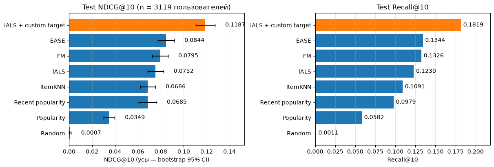

# Рекомендации поэзии на Goodreads

**Студент:** Бородин Александр Павлович

**Датасет:** Goodreads Book Graph, жанровая подвыборка **Poetry** - UCSD, Mengting Wan & Julian McAuley
([RecSys 2018](https://doi.org/10.1145/3240323.3240369), [ACL 2019](https://aclanthology.org/P19-1248/)).
Страница датасета: <https://cseweb.ucsd.edu/~jmcauley/datasets/goodreads.html>.
Файлы скачиваются напрямую с `https://mcauleylab.ucsd.edu/public_datasets/gdrive/goodreads/` скриптом `scripts/download_data.py`.

**Задача:** для каждого пользователя - 10 поэтических книг, которые он добавит на полку и оценит на 4-5 звёзд в следующем периоде.
Глобальное временное разбиение: train до 2017-03-01, validation март-май 2017, test июнь-октябрь 2017.
Основная метрика - NDCG@10, вторая - Recall@10.

После очистки: **1 315 602** пары пользователь-произведение, **32 599** пользователей, **10 096** произведений
(издания склеены в произведения, 15-core по train-периоду).



*Результаты на test: 3 119 пользователей, refit на train + val. Усы показывают bootstrap 95% CI для NDCG@10.*

## Протокол оценки

Релевантно произведение, которое пользователь впервые добавил в окне validation/test и оценил на ≥ 4 до конца окна.
Все модели используют одни разбиения, пользователей, кандидатов и правила оценки.
Кандидаты - каталог с взаимодействиями до cutoff; уже добавленные произведения исключаются, включая to-read и низкие оценки.
Оценка проводится на тёплых пользователях и произведениях после 15-core по train, только на пользователях с релевантными книгами в окне.
Оценки, прочтения и рецензии доступны модели только после соответствующего события; признаки пользователя строятся по истории до cutoff.
Настройки выбираются по validation NDCG@10, затем модели переобучаются на train + val для финального сравнения на test.

## Модели (реализованы с нуля: NumPy, SciPy, PyTorch)

| # | модель | файл |
|---|---|---|
| 1 | Item-based CF: косинус со сжатием, top-k соседей | `models/item_knn.py` |
| 2 | iALS (Hu, Koren, Volinsky), шаги CG на GPU | `models/ials.py` |
| 3 | EASE, замкнутое решение | `models/ease.py` |
| 4 | Factorization Machine + BPR, метапризнаки книги и пользователя | `models/fm.py`, `core/features.py` |
| 5 | iALS с собственной целью - затухающий интерес к cutoff; выбранная цель $p = 2^{-\Delta t/730}$, уверенность зависит от типа взаимодействия и наличия рецензии | `models/ials_custom.py`, `core/signals.py` |
| - | baselines: случайный, популярность, свежая популярность (окно подбирается) | `models/popularity.py` |

Для FM используются ID, метапризнаки книги (первый автор, год, страницы, формат, язык, издатель, TF-IDF описания,
популярность по истории) и пользователя (активность, средняя оценка, доля полок без оценки и прочтения, профиль авторов).
Снимковые счётчики рейтингов, рецензий и полок из метаданных не используются.

В модели 5 $\Delta t$ - число дней после последнего известного события пары (полка, оценка, прочтение).
Нормализация оценки относительно среднего пользователя и отдельная обработка низких оценок проверялись при подборе,
но validation выбрал их отключение: `tau=None`, `alpha_neg=None`. Параметры факторизации и решателя взяты у лучшего базового iALS.
Для наблюдаемых пар выбранная уверенность $c = 1 + 50w + 5\mathbf1[\text{рецензия}]$,
где $w=0.3$ для полки без оценки и прочтения, иначе $w=1$. Для ненаблюдаемых пар $p=0$, $c=1$.

## Результаты на test

Июнь-октябрь 2017, 3 119 тёплых пользователей, модели переобучены на train + val. В квадратных скобках - bootstrap 95% CI для NDCG@10.

| модель | NDCG@10 | Recall@10 | HitRate@10 | гиперпараметры (выбраны по val NDCG@10) |
|---|---|---|---|---|
| **iALS + custom target** | **0.1187** [0.1105; 0.1273] | **0.1819** | **0.2562** | d=256, λ=300, α=50; h=730 дн., w_shelf=0.3, α_rev=5; tau=None, alpha_neg=None |
| EASE | 0.0844 [0.0776; 0.0917] | 0.1344 | 0.1969 | λ=500, все полки |
| FM | 0.0795 [0.0726; 0.0864] | 0.1326 | 0.1933 | ID + книга + пользователь, d=64, lr=1e-3, λ=1e-3, 30 эпох |
| iALS | 0.0752 [0.0687; 0.0823] | 0.1230 | 0.1831 | d=256, λ=300, α=50 |
| ItemKNN | 0.0686 [0.0620; 0.0753] | 0.1091 | 0.1619 | k=200, shrinkage=10, все полки |
| Recent popularity | 0.0685 [0.0606; 0.0764] | 0.0979 | 0.1276 | окно 30 дней |
| Popularity | 0.0349 | 0.0582 | 0.0795 | - |
| Random | 0.0007 | 0.0011 | 0.0022 | - |

Полная таблица: [artifacts/test/metrics.csv](artifacts/test/metrics.csv).
Подбор, графики, абляции и примеры рекомендаций: [experiments.ipynb](experiments.ipynb).

## Выводы

- **Учёт времени полезен.** Recent popularity за 30 дней даёт NDCG@10 = 0.0685 против 0.0349 у популярности за всю историю и почти совпадает с ItemKNN (0.0686).
- **Модель 5 показала лучшее качество.** При тех же параметрах факторизации и решателе выигрыш над iALS составляет 0.0435 NDCG@10 (+58%; paired bootstrap 95% CI [0.0363; 0.0509]), над EASE - 0.0343 [0.0271; 0.0418]. Отключение затухания снижает качество на 0.0364; перенос затухания из цели в уверенность - на 0.0237 [0.0176; 0.0298].
- **Не все компоненты сигнала полезны.** На test интервалы разниц при отключении веса полки или бонуса рецензии включают ноль.
- **Пользовательские метапризнаки помогли FM.** При общих выбранных lr и λ лучший val NDCG@10: 0.0714 для ID, 0.0694 для ID + книга, 0.0751 для ID + книга + пользователь. Отдельный вклад профиля авторов этой абляцией не выделен.
- **Лидеры сохраняются на test.** Модель 5 и EASE лидируют на обоих окнах; FM и iALS меняются местами.
- **Покрытие каталога ниже у лидера.** Coverage@10 модели 5 - 6.5% против 17.9% у iALS и 13.9% у EASE. Разнообразие внутри отдельных списков не измерялось.

## Ограничения

- Один жанр и одно test-окно; переносимость на другие жанры и периоды не проверялась.
- Оценка только после 15-core по train и на пользователях с релевантными книгами в окне; холодный старт не оценивался.
- `date_updated` приближает время оценки; полной истории изменений нет. Метаданные книг представлены снимком без истории редактирования.
- Один seed обучения; пользовательский bootstrap не оценивает вариативность между повторными обучениями.
- Поиск ограничен заданными сетками; параметры факторизации модели 5 взяты у базового iALS и отдельно под новую цель не подбирались.

## Структура

```
experiments.ipynb   основной ноутбук: данные, EDA, протокол, подбор, test, выводы
config.py           все параметры: пути, SEED, границы периодов, сетки подбора
models/             по файлу на модель + общий интерфейс (base.py)
core/               данные, разбиение без утечки, метрики, оценщик, признаки FM, сигнал модели 5,
                    подбор, графики (matplotlib)
scripts/            download_data.py, prepare_data.py, run_all.py
tests/              проверки на игрушечных данных: метрики, отсутствие утечки, EASE, iALS, FM
```

## Запуск

Python ≥ 3.11. С [uv](https://docs.astral.sh/uv/):

```bash
uv sync
uv run python scripts/download_data.py    # ~240 МБ в data/raw
uv run python scripts/prepare_data.py     # raw -> interim -> processed
uv run pytest                            # проверки моделей и протокола
uv run jupyter nbconvert --execute --to notebook --inplace experiments.ipynb
```

Без uv: `pip install -r requirements.txt` и те же команды через `python`.
Подбор и тест кешируются в `artifacts/`; `uv run python scripts/run_all.py --force` пересчитывает всё.
По замеру, указанному в ноутбуке, выполнение занимает около 30 минут на NVIDIA GeForce RTX 5060 Ti с 16 ГБ VRAM;
на CPU заметно дольше. Зерно - `config.SEED = 42`.
Данные, окружение и тяжёлые артефакты исключены через `.gitignore`.
В репозиторий входят итоговые `artifacts/test/metrics.csv` и `artifacts/test/best_params.json`.
